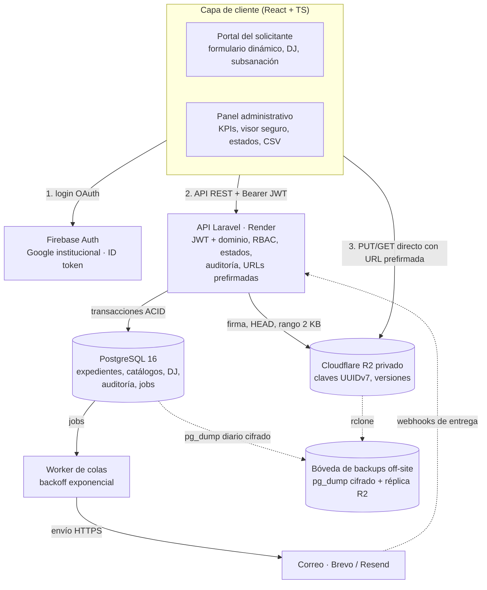
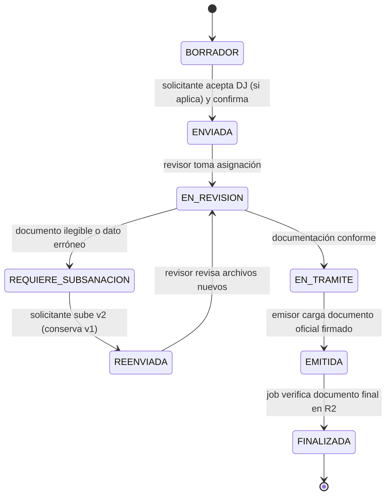

# Sistema de Gestión de Trámites y Solicitudes Documentarias — Diseño técnico

> Versión 2.0 · 21-oct-2026 · DSA-UNSA
> Alineado con el "Documento de Arquitectura de Software y Plan de Implementación" (21-oct-2026).
> Costos, planes gratuitos, requisitos legales y plan por fases: documento "Sistema de Trámites UNSA — Arquitectura de costos y entornos".
> Tipo de cambio referencial del documento base: USD 1,00 = PEN 3,44.

## 1. Alcance

- Volumen: **~3.000 solicitudes/mes**, con picos de concurrencia en cierres de semestre.
- Solicitantes: estudiantes y egresados. Gestores: personal administrativo de la DSA, área académica y Unidad de Posgrado.
- Trámites con formulario dinámico por tipo (Certificado, Boleta de Notas, Posgrado, etc.), declaración jurada cuando aplica,
  adjuntos privados, subsanación con versionado de archivos y emisión de documento oficial.

Principios: costo fijo mínimo (los binarios nunca pasan por el backend), autorización siempre en servidor,
integridad transaccional (ACID) en cada cambio de estado y portabilidad por estándares (Docker, PostgreSQL, S3, OIDC).

## 2. Stack y justificación

| Capa | Tecnología | Por qué |
| --- | --- | --- |
| Frontend | React 19 + TypeScript + Tailwind CSS (Vite), dos aplicaciones: Portal del solicitante y Panel administrativo | Tipado estricto para formularios dinámicos; build estático a costo cero |
| Identidad | Firebase Authentication, proveedor Google | Sin contraseñas propias; ID token JWT firmado (OIDC); 50.000 MAU gratis |
| API | Laravel 11/12, PHP 8.3+, nginx + php-fpm en Docker (Render) | Colas, Policies/Gates, validación por *magic bytes*, migraciones, Flysystem S3 nativos |
| Worker | Laravel Queue Worker (driver `database`) | Reintentos con *exponential backoff* para correos y verificaciones |
| Base de datos | PostgreSQL 16+ | ACID + JSONB para metadatos variables por tipo de trámite |
| Archivos | Cloudflare R2, bucket privado | Egreso gratis; URLs prefirmadas de 5 min |
| Correo | Brevo o Resend vía API HTTP | Entregabilidad (SPF/DKIM/DMARC) y webhooks de estado de entrega |
| Respaldos | Bóveda off-site: `pg_dump` cifrado diario + réplica `rclone` de R2 | Recuperación independiente del proveedor principal |

## 3. Arquitectura



## 4. Identidad y autorización

1. El frontend usa `signInWithPopup(GoogleAuthProvider)` con `hd=unsa.edu.pe` como **pista de interfaz** solamente.
2. Cada request lleva `Authorization: Bearer <ID token>`.
3. Middleware `VerifyFirebaseToken`: firma contra JWKS de Google (cacheado), `aud`, `iss`, `exp`, `iat`,
   `email_verified = true`, `firebase.sign_in_provider = google.com` y dominio del `email` en la lista permitida.
   No se confía en `hd`: el ID token de Firebase no garantiza ese claim; el dominio se valida sobre `email`.
4. Usuarios y roles viven en PostgreSQL (sin *custom claims*): Firebase queda reemplazable.

| Rol | Alcance |
| --- | --- |
| `solicitante` | Estudiante o egresado: crea, envía, subsana y descarga sus trámites |
| `revisor` | Personal DSA: toma expedientes, revisa, observa, deriva a trámite |
| `emisor` | Área académica / Unidad de Posgrado: valida autorizaciones, carga documento oficial |
| `jefe` | Reasigna, ve todas las bandejas, KPIs y exportes CSV |
| `auditor` | Solo lectura de expedientes y bitácora |
| `admin` | Usuarios, roles, catálogos y versiones de formularios / DJ |

**Pendiente crítico**: los egresados pueden no conservar su cuenta `@unsa.edu.pe`. Si es así, el login solo-institucional
los excluye y se necesita una vía alterna (cuenta Google personal verificada contra el padrón de egresados).

## 5. Modelo de datos

```text
users                 (id uuid PK, provider, provider_sub, email UNIQUE, nombres, dni NULL, codigo NULL,
                       tipo ['estudiante','egresado','personal'], activo, timestamps)   UNIQUE(provider, provider_sub)
roles, role_user

tipos_tramite         (id, codigo UNIQUE, nombre, area_emisora, activo)
tipo_tramite_versiones(id, tipo_tramite_id FK, version, form_schema jsonb, requisitos jsonb,
                       declaracion_jurada_id FK NULL, plazo_dias, vigente_desde, vigente_hasta NULL)
declaraciones_juradas (id, version, texto, sha256, vigente_desde)

solicitudes           (id uuid PK, codigo UNIQUE 'TRM-2026-000123', solicitante_id FK,
                       tipo_tramite_version_id FK, estado, datos jsonb, asignado_a FK NULL,
                       dj_id FK NULL, dj_aceptada_at NULL, dj_ip NULL, dj_sha256 NULL,
                       enviada_at, fecha_limite, timestamps)
                       INDEX(estado), INDEX(solicitante_id), INDEX(asignado_a, estado)

archivos              (id uuid PK, solicitud_id FK NULL, requisito_codigo, version int, object_key UNIQUE,
                       nombre_original, mime_detectado, bytes, sha256,
                       origen ['solicitante','emitido'], estado ['pendiente','verificado','rechazado','reemplazado'],
                       reemplaza_a_id FK NULL, subido_por FK, timestamps)
                       UNIQUE(solicitud_id, requisito_codigo, version)

observaciones         (id, solicitud_id FK, archivo_id FK NULL, motivo, creada_por FK, subsanada_at NULL, created_at)
solicitud_eventos     (id bigserial, solicitud_id FK, actor_id FK NULL, desde, hasta, comentario, created_at)
auditoria             (id bigserial, actor_id FK NULL, accion, entidad, entidad_id, ip, user_agent, meta jsonb, created_at)
notificaciones        (id bigserial, solicitud_id FK, destinatario, plantilla, proveedor, provider_message_id,
                       estado ['encolada','enviada','entregada','rebotada','fallida'], intentos, ultimo_error, timestamps)
jobs, failed_jobs     (cola de Laravel sobre PostgreSQL)
```

Reglas:

- `form_schema` define los campos del formulario dinámico; la solicitud guarda **la versión** con que se llenó.
- La DJ aceptada se congela por `dj_id` + `dj_sha256` + timestamp + IP: probatorio aunque el texto cambie después.
- Un archivo nunca se sobreescribe: la subsanación crea `version = n+1` con `reemplaza_a_id` y la anterior pasa a `reemplazado`.
- `auditoria` es solo-INSERT para el rol de base de datos de la aplicación.

## 6. Máquina de estados (solo en backend)



| Transición | Actor | Precondición | Efecto en la misma transacción |
| --- | --- | --- | --- |
| BORRADOR → ENVIADA | solicitante | Requisitos obligatorios con archivo `verificado`; DJ aceptada si aplica | Código único, evento, auditoría, correo "Solicitud registrada" |
| ENVIADA → EN_REVISION | revisor | Sin asignación previa | `asignado_a`, evento |
| EN_REVISION → REQUIERE_SUBSANACION | revisor | Al menos una observación | Observaciones, evento, correo con motivo y enlace |
| REQUIERE_SUBSANACION → REENVIADA | solicitante | Cada observación con archivo nuevo `verificado` | Versiones n+1, evento |
| REENVIADA → EN_REVISION | revisor | — | Evento |
| EN_REVISION → EN_TRAMITE | revisor | Sin observaciones abiertas | Evento, derivación al emisor |
| EN_TRAMITE → EMITIDA | emisor | Documento oficial cargado (`origen = emitido`) | Evento, correo "Documento emitido" |
| EMITIDA → FINALIZADA | sistema (job) | Documento final verificado en R2 | Evento, correo "Trámite concluido" con instrucciones de descarga |

Implementación: una clase `SolicitudStateMachine` con tabla de transiciones permitidas; cada transición en
`DB::transaction()` y el correo se encola con `afterCommit` para no notificar cambios revertidos.

Vacíos del diseño base a decidir: no hay estado de **rechazo/improcedencia**, **anulación** por el solicitante,
ni **vencimiento** del plazo de subsanación. Sin ellos, los expedientes inviables quedan abiertos indefinidamente.

## 7. Carga y descarga con URLs prefirmadas

1. El frontend valida tamaño (< 5 MB) y tipo, y calcula SHA-256.
2. `POST /api/v1/uploads/presign` `{requisito_codigo, nombre, bytes, mime, sha256}` → el API valida JWT, rol y estado,
   genera `object_key = incoming/{uuidv7}`, crea `archivos` en `pendiente` y firma un PUT de 5 min con
   `Content-Type` y `Content-Length` fijados. Responde `{upload_url, file_key}`.
3. El navegador hace PUT directo a R2.
4. `POST /api/v1/solicitudes` (o `/subsanaciones`) con los `file_key`. El API hace `HEAD` (tamaño exacto) y
   `GET` con `Range: bytes=0-2047` para validar *magic bytes* (`%PDF-`, JPEG `FF D8 FF`, PNG `89 50 4E 47`);
   mueve la clave a `solicitudes/{solicitud_uuid}/{uuidv7}` y marca `verificado`.
   La comprobación del SHA-256 completo (≤ 5 MB) va a un job del worker.
5. Descarga y visor seguro: `GET /api/v1/archivos/{id}/url` → verifica permiso, registra en auditoría y devuelve
   GET prefirmado de 5 min (`inline` para el visor del panel, `attachment` para descarga).
6. Regla de ciclo de vida en R2: borrar `incoming/` con más de 1 día (subidas nunca confirmadas).

Bucket: sin acceso público ni `r2.dev`; CORS solo para los orígenes del portal y del panel (`PUT`, `GET`, `HEAD`);
token de API limitado al bucket. R2 cifra en reposo.

## 8. API v1

| Método | Ruta | Rol |
| --- | --- | --- |
| GET | `/api/v1/me` | autenticado |
| GET | `/api/v1/tipos-tramite` (incluye `form_schema` vigente y DJ) | autenticado |
| POST | `/api/v1/uploads/presign` | solicitante, emisor |
| POST / GET | `/api/v1/solicitudes` | solicitante (propias) / revisor+ (bandeja) |
| GET | `/api/v1/solicitudes/{codigo}` | dueño, asignado, emisor, jefe, auditor |
| POST | `/api/v1/solicitudes/{codigo}/subsanaciones` | dueño |
| POST | `/api/v1/solicitudes/{codigo}/transiciones` | revisor, emisor, jefe |
| POST | `/api/v1/solicitudes/{codigo}/observaciones` | revisor |
| GET | `/api/v1/archivos/{id}/url` | según Policy |
| GET | `/api/v1/kpis`, `/api/v1/exportes/solicitudes.csv` | jefe, auditor |
| CRUD | `/api/v1/admin/catalogos`, `/declaraciones`, `/usuarios` | admin |
| POST | `/api/v1/webhooks/email/{proveedor}` | firma del proveedor |
| GET | `/health` | público, sin datos |

JSON, paginación por cursor, errores RFC 9457, *rate limiting* por usuario e IP (más estricto en `presign`).

## 9. Procesos asíncronos

| Job | Disparador | Reintentos |
| --- | --- | --- |
| `EnviarNotificacion` | Cada transición (afterCommit) | `tries=5`, backoff `[60, 300, 900, 3600]` s |
| `VerificarHashArchivo` | Confirmación de archivo | `tries=3` |
| `FinalizarTramite` | Archivo emitido verificado | `tries=3` |
| `ProcesarWebhookCorreo` | Webhook del proveedor | `tries=3` |
| `LimpiarPendientes` | Scheduler diario | — |
| `BackupDiario` | Scheduler / cron nocturno | Alerta si falla |

Despliegue del worker:

- **Dev/QA**: mismo contenedor que el API (supervisord). Con la instancia Free dormida, la cola también duerme: aceptable en pruebas.
- **Producción**: Background Worker de Render aparte (misma tarifa que un web service) o el mismo contenedor si se prioriza costo.
  Separado escala y reinicia independiente del API.

## 10. Bóveda de respaldos

- `pg_dump -Fc` diario, cifrado con `age` (clave pública en el servidor, privada fuera de línea), a un bucket R2
  **en otra cuenta de Cloudflare** con *bucket lock* (retención, p. ej., 35 días) para que nadie pueda borrarlo desde la app.
- Réplica diaria de objetos con `rclone sync` hacia la misma bóveda.
- Ejecutor: cron de Render (mínimo USD 1/mes) en producción.
- Prueba de restauración trimestral documentada.

## 11. Entornos

| Aspecto | Local | Dev / QA | Producción |
| --- | --- | --- | --- |
| Datos | Sintéticos | **Solo sintéticos** | Reales |
| Frontends | Vite | Cloudflare (preview por rama) | Cloudflare, subdominios institucionales |
| Firebase | Auth Emulator | `unsa-tramites-dev` | `unsa-tramites-prod` |
| API + worker | Docker Compose | Render Free (un contenedor) | Render pagado (API + worker) |
| PostgreSQL | Contenedor | Neon Free | Render Postgres pagado + PITR |
| R2 | Disco `local` | `tramites-dev` | `tramites-prod` |
| Bóveda | — | — | Cuenta Cloudflare separada, bucket con lock |
| Correo | Mailer `log` | Brevo/Resend Free | Brevo/Resend con dominio autenticado |

Ninguna credencial se comparte entre entornos.

## 12. Seguridad

HTTPS/HSTS; CSP estricta; CORS cerrado; Form Requests; logs sin datos personales; auditoría de login, lectura de
expediente ajeno, cada URL de descarga emitida, cada transición y cambios de rol; correos **sin adjuntos sensibles**
(solo enlace al expediente); `composer audit` y `npm audit` en CI.

## 13. Portabilidad

API (Docker) → cualquier host de contenedores o servidor UNSA · PostgreSQL → `pg_dump` · R2 → `rclone` a S3/B2/GCS ·
Firebase → Socialite contra Google OIDC (usuarios y roles ya son locales) · Correo → cambio de *mailer* · Frontends → cualquier CDN.

## 14. Decisiones pendientes

- [ ] Acceso de egresados sin cuenta institucional.
- [ ] Estados de rechazo, anulación y vencimiento de subsanación.
- [ ] Catálogo inicial de tipos de trámite, `form_schema` y textos de DJ (revisión legal).
- [ ] Límite de 5 MB frente a escaneos multipágina.
- [ ] Mecanismo de firma del documento oficial emitido.
- [ ] Retención de archivos y expedientes.
- [ ] Proveedor de correo de producción.
- [ ] Modalidad de pago en USD; subdominios con la OTI; validación legal (Ley 29733).
